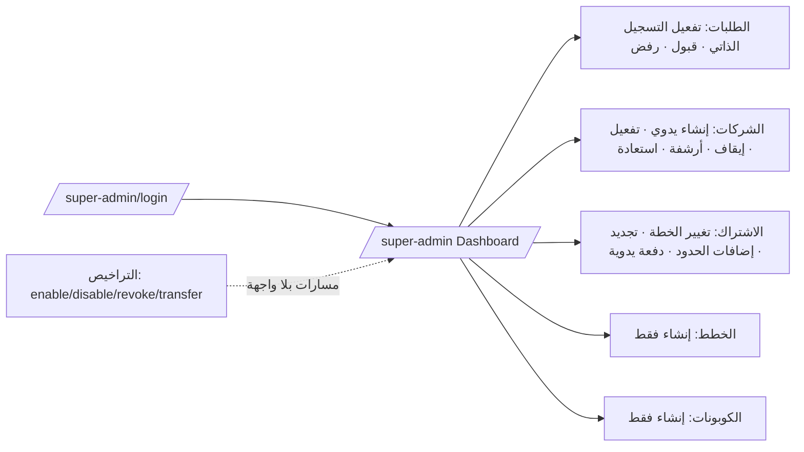

# تقرير التدقيق الشامل للوحة السوبر أدمن — E‑Zaki ERP

> تدقيق **للقراءة فقط**. لم يُعدَّل أي ملف من ملفات التطبيق، ولم تُشغَّل ترحيلات أو اختبارات أو بناء أثناء التدقيق. الملف الوحيد المُنشأ هو هذا التقرير.

---

## 1. نطاق التدقيق ومنهجيته

**النطاق:** كل ما يخص منطقة المنصة (Super Admin / `account_type = super_admin`): الدخول والجلسات، المسارات والميدلوير، لوحة المنصة (`SuperAdmin/Dashboard.jsx`)، دورة حياة الشركات (Provisioning/Suspend/Archive/Restore)، الخطط والاشتراكات والمدفوعات اليدوية، حدود الاستخدام (Entitlements)، التراخيص المحلية، الكوبونات، إعدادات المنصة، سجل التدقيق وسجل الدخول، الـ API، قاعدة البيانات، الإشعارات والمهام المجدولة، النسخ الاحتياطي، والـ UI/UX.

**المنهجية:**
1. قراءة ثابتة (Static) للمسارات (`routes/web.php`, `routes/api.php`, `routes/console.php`) و`bootstrap/app.php`.
2. تتبع الميدلوير: `CheckAccountType`, `ScopeSessionCookie`, `EnsureSessionVersion`, `SetTenantContext`, `CheckSubscriptionStatus`, `EnsureLocalLicense`, `SecurityHeaders`, `TrustProxies`, `HandleInertiaRequests`.
3. تتبع الخدمات: `AuthenticationService`, `CompanyProvisioningService`, `SubscriptionLifecycle`, `CompanyLimitService`, `CouponRedemptionService`, `LocalLicenseService`, `ManualPaymentGateway`, `AuditRecorder`, `SessionRevocationService`, `CompanyAccountingPolicyService`.
4. مراجعة النماذج (`$fillable/$hidden/casts`) والترحيلات الخاصة بجداول المنصة.
5. مراجعة الواجهة `resources/js/Pages/SuperAdmin/Dashboard.jsx`, `Auth/Login.jsx`, `navigation.js`, `bootstrap.js`.
6. مراجعة الاختبارات الموجودة وفجواتها، و`DEPLOYMENT.md`, `.env.example`, أوامر الـ Console.

**ما لم يُفعل عمدًا:** لا تشغيل ترحيلات، لا تغيير ملفات، لا تثبيت حزم، لا اتصال بقاعدة بيانات حقيقية، لا تفعيل/إلغاء أي ترخيص.

**مصطلحات التصنيف:** Severity = Critical/High/Medium/Low/Informational. Confidence = Confirmed (مثبت من الكود) / Probable (مرجّح بشروط) / Needs verification (يحتاج بيئة فعلية).

---

## 2. نسخة المشروع والبيئة التي تمت مراجعتها

| البند | القيمة |
|---|---|
| المستودع | `d:\xampp\htdocs\ezaki-erp-v1` |
| آخر Commit (HEAD) | `921a2e909b11abec615514ec94e1825da93b1608` |
| حالة شجرة العمل عند البدء | **غير نظيفة**: توجد تعديلات غير مرحّلة من مهام سابقة (المحاسبة/التسويات)؛ سُجّلت قبل التدقيق ولم تتغير بسببه |
| الإطار | Laravel ^12.0، PHP ^8.2 (البيئة المحلية 8.2.4)، Sanctum 4.*، Spatie Permission 6.* (teams: `company_id`)، Inertia 2.* |
| الواجهة | React 19 + Inertia + Vite 6 |
| قاعدة البيانات | MySQL (الإنتاج/التطوير المحلي)، SQLite في الذاكرة للاختبارات |
| الـ Edition | `APP_EDITION=saas` افتراضيًا، و`local` للتثبيت المحلي بترخيص |
| المنطقة الزمنية | `UTC` ثابتة في `config/app.php` |

---

## 3. ملخص تنفيذي

**التقييم العام للجاهزية: 6.0 / 10 — مناسبة للإنتاج بشروط (Suitable with conditions).**

### أهم نقاط القوة
1. **فصل جلسات المنصة والشركات** بكوكيز مختلفة عبر `ScopeSessionCookie` مع اختبار (`PhaseFourReleaseTest`)، وفرض `account.type:super_admin` على كل مسارات `/super-admin`.
2. **المصادقة محصّنة نسبيًا:** رسائل خطأ عامة، تجزئة وهمية لمنع توقيت المستخدم غير الموجود (`DUMMY_PASSWORD_HASH`)، قفل تصاعدي، `throttle:login` بمفتاحين (IP + حساب)، تجديد الجلسة `regenerate()`، و`session_version` لإبطال الجلسات.
3. **الترخيص المحلي Fail‑Closed:** توقيع RSA‑SHA256، ربط بالتثبيت والعميل والشركة، إعادة تحقق من الحمولة المخزنة في كل طلب، وسجل `local_license_audits` مع إبطال/نقل Idempotent وأقفال `lockForUpdate`.
4. **استرداد الكوبونات آمن للتزامن** (قفل صف + `unique` + Idempotency) ومغطى باختبار.
5. **إنشاء الشركات داخل Transaction** مع أقفال على الخطة والكوبون، وتحقق من البريد المكرر، وتدقيق الأحداث.
6. **لا يوجد Impersonation** ولا وصول دعم خفي؛ لا توجد مسارات تعدّل بيانات الشركات المالية من المنصة.

### أهم المخاطر
1. **لا MFA ولا إعادة مصادقة (Step‑up)** لحساب يملك سلطة على كل الشركات والاشتراكات والتراخيص (SA-AUTH-002).
2. **تسجيل الدفعات اليدوية غير مُسوّى ومدمّر للتواريخ:** دفعة `paid` بأي مبلغ (حتى 0) تعيد ضبط `starts_at=now` وتمدد من الآن بدل الإضافة على الرصيد، دون Transaction/قفل ودون تحديث حالة الشركة (SA-SUB-001).
3. **تغيير الخطة يكتب فوق صف الاشتراك** ويمسح تاريخه، بلا فحص حدود الاستخدام عند التخفيض ولا تأكيد (SA-SUB-002).
4. **صلاحيات المنصة مستوى واحد:** كل super admin يملك كل شيء، بلا أدوار ولا حماية لآخر مدير ولا واجهة لإدارة المديرين (SA-SEC-001).
5. **الميزات (`plans.features`) غير مُطبَّقة إطلاقًا**، وحدّ "الإضافات" يقلب الخطة غير المحدودة إلى محدودة (SA-ENT-001, SA-SUB-003).
6. **سجل التدقيق ضعيف التفاصيل** (لا قبل/بعد ولا سبب ولا Request ID ولا User‑Agent) وقابل للتعديل، ولا توجد واجهة لعرضه (SA-AUD-001).

### أهم التوصيات العاجلة
R-01 MFA/Step‑up، R-02 إعادة تصميم تسجيل الدفعات والتجديد، R-03 تغيير الخطة بسجل تاريخي وفحص الحدود، R-04 صلاحيات منصة (أدوار) وحماية آخر مدير، R-05 تحسين سجل التدقيق وإضافة واجهة عرض، R-06 تقييد `TRUSTED_PROXIES` وتحديد نطاق remember‑me.

**القرار:** اللوحة تعمل وظيفيًا وآمنة في أساسياتها، لكنها **تحتاج معالجة العناصر High والـ Medium ذات الصلة بالمال والاشتراكات قبل الاعتماد عليها كمنصة SaaS تجارية** تدير عملاء حقيقيين. مناسبة حاليًا لتشغيل محدود بإشراف عدد صغير جدًا من المديرين الموثوقين.

---

## 4. ما تم فحصه وما لم يمكن التحقق منه

| الفئة | الحالة | التفاصيل |
|---|---|---|
| فحص ثابت للكود | تم | كل ما ورد في القسم 1 |
| تغطية الاختبارات الموجودة | تم بالقراءة | قُرئت أسماء ومحتوى الاختبارات ذات الصلة. **آخر تشغيل كامل** (قبل التدقيق وفي مهمة سابقة): PHPUnit 147 اختبارًا نجحت (تخطي 2)، Node 42 اختبارًا نجحت. لم يُعاد تشغيلها أثناء التدقيق للحفاظ على القراءة فقط |
| التحقق اليدوي في المتصفح | **لم يتم** | لا متصفح/اعتماديات متاحة؛ لا يمكن تأكيد سلوك RTL والاستجابة فعليًا |
| MySQL فعلي (EXPLAIN, strict mode, FK) | لم يتم | مذكور في `DEPLOYMENT.md` كمتطلب بيئة |
| تدفقات البريد/SMTP/Queue Worker | لم يتم | `MAIL_MAILER=log` افتراضيًا |
| توقيع ترخيص حقيقي | لم يتم | اختباران يتخطّيان لأن PHP CLI لا يولّد مفتاح OpenSSL (`PhaseOneFoundationTest:605`, `SecurityPlatformHardeningTest:170`) |
| حمل/أداء/اختراق ديناميكي | لم يتم | تقديرات أداء ثابتة فقط |

---

## 5. خريطة لوحة السوبر أدمن والوظائف الحالية

| الوظيفة | موجودة؟ | الملاحظة |
|---|---|---|
| لوحة مؤشرات (KPIs) | **لا** | الصفحة قوائم وسجلات وليست مؤشرات |
| قبول/رفض التسجيل | نعم | الرفض بلا سبب (`review_notes` غير مستخدم) |
| إنشاء شركة ومالك | نعم | `createManually` |
| إيقاف/تفعيل/أرشفة/استعادة | نعم | بلا سبب، وبلا تأكيد عدا الأرشفة |
| تغيير الخطة/التجديد/الإضافات | نعم | انظر SA-SUB |
| تسجيل دفعة يدوية | نعم | انظر SA-SUB-001 |
| إنشاء خطة/كوبون | نعم | لا تعديل/تعطيل |
| إدارة التراخيص | مسارات فقط | لا صفحة تعرضها (`SuperAdminLicenseController`) |
| إدارة مديري المنصة | **لا** | الأمر `app:create-super-admin` فقط |
| سجل التدقيق/الدخول للمنصة | **لا** | يُكتب ولا يُعرض (إلا نشاط المستخدم داخل الشركة) |
| إدارة مستخدمي الشركات من المنصة | لا (جيد) | لا Impersonation |
| تقارير/تصدير المنصة | لا | — |

---

## 6. مصفوفة المسارات والصلاحيات والميدلوير

### 6.1 مسارات المنصة (`prefix super-admin`, `middleware: auth, account.type:super_admin, session.version`)

| Route/name | Method | Purpose | Middleware/policy | Permission | Company/platform scope | Finding |
|---|---|---|---|---|---|---|
| `/super-admin` `super-admin.dashboard` | GET | لوحة المنصة | auth+account.type+session.version | لا (أي super admin) | منصة، يرى كل الشركات | SA-DASH-001, SA-RPT-001 |
| `/super-admin/logout` | POST | خروج | نفس المجموعة | لا | منصة | آمن |
| `/super-admin/registration-setting` | POST | فتح/غلق التسجيل الذاتي | نفس | لا | عالمي | SA-SET-001 |
| `/super-admin/plans` `plans.store` | POST | إنشاء خطة | نفس | لا | عالمي | SA-CPN-001 |
| `/super-admin/coupons` `coupons.store` | POST | إنشاء كوبون | نفس | لا | عالمي | SA-CPN-001 |
| `/super-admin/registrations/{registration}/approve` | POST | قبول وتجهيز شركة | نفس + Transaction | لا | عالمي | SA-PROV-002 |
| `/super-admin/registrations/{registration}/reject` | POST | رفض | نفس | لا | عالمي | بلا سبب |
| `/super-admin/companies` `companies.store` | POST | إنشاء شركة يدويًا | نفس | لا | عالمي | SA-PROV-001/002 |
| `/super-admin/subscriptions/{subscription}/payments` | POST | تسجيل دفعة | نفس | لا | أي اشتراك بالـ ID | **SA-SUB-001** |
| `/super-admin/companies/{company}/activate` | POST | تفعيل | نفس + Tx | لا | أي شركة | SA-LIFE-001 |
| `/super-admin/companies/{company}/suspend` | POST | إيقاف | نفس + Tx | لا | أي شركة | SA-LIFE-001/002 |
| `/super-admin/companies/{company}/archive` | POST | أرشفة | نفس + Tx | لا | أي شركة | — |
| `/super-admin/companies/{company}/restore` | POST | استعادة | نفس + Tx | لا | أي شركة | SA-LIFE-001 |
| `/super-admin/companies/{company}/plan` | POST | تغيير الخطة | نفس + Tx (بلا قفل) | لا | أي شركة | **SA-SUB-002** |
| `/super-admin/companies/{company}/renew` | POST | تجديد + دفعة | نفس + Tx + `lockForUpdate` | لا | أي شركة | SA-SUB-001 |
| `/super-admin/companies/{company}/limit-addons` | PUT | إضافات حدود | نفس (بلا Tx) | لا | أي شركة | SA-SUB-003 |
| `/super-admin/licenses/{license}/enable|disable|revoke` | POST | حالة الترخيص | نفس + Tx + قفل | لا | عالمي | SA-LIC-001 |
| `/super-admin/licenses/{license}/transfer` | POST | نقل ترخيص | نفس + Tx + قفل + تحقق توقيع | لا | عالمي | SA-LIC-001 |

**ملاحظات:** لا توجد مسارات GET مدمّرة في المنصة. كل التعديلات POST/PUT. لا يوجد `throttle` على مسارات التعديل (SA-SEC-002). لا توجد Closures في مجموعة المنصة، فـ `route:cache` آمن. الربط بالنموذج (`{company}`, `{license}`…) بـ ID عالمي وهو مقبول لأن المنصة ترى كل شيء، **لكن** `{subscription}` في الدفعات يقبل أي اشتراك قديم/مؤرشف.

### 6.2 مسارات الدخول والضيوف

| Route | Method | Middleware | ملاحظة |
|---|---|---|---|
| `/super-admin/login` | GET/POST | `guest`, `throttle:login` | نوع الحساب `super_admin` مفروض في `AuthenticationService::authenticate` |
| `/login` | GET/POST | `guest`, `throttle:login` | `company` |
| `/forgot-password`, `/reset-password` | GET/POST | `guest`, `throttle:3,1` | **مشترك مع المنصة** (SA-AUTH-003) |
| `/register`, `/register/verify/{registration}` | GET/POST/GET | `guest`+`throttle:3,1` / `signed` | SA-PROV-003, SA-REG-001 |
| `/logout` | POST | `auth` | للشركة؛ للمنصة `/super-admin/logout` |
| `/locale/{locale}` | POST | — | مشترك |
| `/up`, `/api/v1/health`, `/api/v1/version` | GET | — | `version` يكشف إصدار Laravel (Informational) |

### 6.3 مجموعات الشركة والـ API (للسياق)
- Web: `auth, account.type:company, tenant, subscription, local.license, session.version`.
- API: `auth:sanctum, session.version, account.type:company, tenant, subscription, local.license` + `can:` + `throttle:api.*`.
- `POST /api/v1/license/activate` عام بلا مصادقة، `throttle:5,1`، ومحصور بـ `edition=local`.

---

## 7. تدقيق المصادقة والجلسات وAccount Type

| البند | التصنيف | الدليل |
|---|---|---|
| فصل نوع الحساب | **Secure** | `AuthenticationService::authenticate` يشترط `account_type === $type`؛ `CheckAccountType` على كل مسارات المنصة؛ اختبارات `test_super_admin_credentials_are_rejected_by_company_login` و`test_super_admin_web_login_accepts_only_the_platform_account_type` |
| رسائل خطأ عامة ومنع توقيت | **Secure** | `AuthenticationController::login`، `DUMMY_PASSWORD_HASH` |
| Session Fixation | **Secure** | `session()->regenerate()` بعد `Auth::login` |
| فصل كوكي الجلسة | **Secure** | `ScopeSessionCookie` (`/super-admin*` → `ezaki-platform-session`) |
| فصل كوكي remember‑me | **Needs improvement** | SA-AUTH-001 |
| Throttling وقفل | **Acceptable** | `throttle:login` (12/IP, 8/حساب) + قفل تصاعدي 5 محاولات/60ث→900ث؛ يسمح بـ DoS على الحساب (SA-AUTH-004) |
| إبطال الجلسات | **Secure** | `session_version` + `SessionRevocationService`؛ إعادة تعيين كلمة المرور تُبطل الجلسات والتوكنات |
| MFA / Step‑up | **High risk** | غير موجود (SA-AUTH-002) |
| سياسة كلمة المرور | **Needs improvement** | إنشاء الأدمن بالأمر: ≥12؛ إعادة التعيين: ≥8 فقط بلا تعقيد |
| Idle/Absolute timeout | **Acceptable** | `SESSION_LIFETIME=120` للجميع؛ لا حد مطلق، لا حد للجلسات المتزامنة |
| الكوكيز الآمنة | **Acceptable** | `secure` افتراضيًا true عند `APP_ENV=production`، `http_only=true`، `same_site=lax`؛ `release:preflight --production` يفحصها |
| CSRF | **Secure** | مجموعة `web` الافتراضية + `X-XSRF-TOKEN` عبر axios؛ اختبارات CSRF سابقة |
| صفحات الخطأ | **Acceptable** | `APP_DEBUG` افتراضيًا false في `config/app.php`؛ `.env.example` يضع `true` للتطوير (يغطيه preflight) |
| `TrustProxies='*'` | **Needs improvement** | SA-AUTH-006 |
| تأكيد البريد الإداري | **Acceptable** | الأدمن ينشأ `email_verified_at=now()` بالأمر |

---

## 8. تدقيق الأمان والحماية من تصعيد الصلاحيات

- **تصعيد أفقي:** المنصة لا تتفاعل مع بيانات الشركة (لا Impersonation)، فلا مسار لمستخدم شركة نحو المنصة: `account.type:super_admin` يُرجع 403. *(لا يوجد اختبار صريح يثبت 403 لمستخدم شركة على `/super-admin/*` — SA-TST-001.)*
- **تصعيد رأسي داخل الشركة:** `CompanyAccessController` يمنع منح صلاحيات لا يملكها الفاعل (`abort_if(array_diff(...))`) وحماية `Company Owner`. لا يتأثر بالمنصة.
- **منح امتياز منصة لمستخدم شركة:** لا يوجد مسار؛ `account_type` و`status` في `User::$fillable` لكن لا مسار ويب/API يمرّر طلب المستخدم إلى `fillable` بلا تحديد حقول (تحقق من `storeUser/updateUser`: حقول صريحة). **آمن حاليًا**، لكن وجود `account_type` في `$fillable` خطر كامن عند أي إضافة مستقبلية (Low).
- **المنصة مسطحة:** كل `super_admin` نشط يملك كل العمليات (SA-SEC-001).
- **Gate::before:** يعيد `true` لمالك الشركة لأي صلاحية — مقبول لأن مسارات المنصة لا تعتمد `can:`؛ لكن إن أُضيفت صلاحيات منصة مستقبلًا مع `can:` فلن تتأثر لأن Super Admin ليس `isCompanyOwner()`.
- **Mass assignment:** `Plan::create([...$data])` و`Coupon::create([...$data])` من مدخلات متحقق منها جزئيًا؛ حقول `features`, `limits.*`, `restrictions` مصفوفات حرة (SA-CPN-001).

---

## 9. تدقيق إدارة الشركات والـTenants

**ما هو جيد:** `createManually`/`approve` داخل `DB::transaction` مع `lockForUpdate` للخطة/الكوبون/الطلب؛ رفض البريد المكرر؛ تهيئة الأدوار (Company Owner / Accounts Manager / Accountant)؛ دفتر حسابات **فارغ عمدًا** حتى يهيئه المالك (اختبار `test_super_admin_company_provisioning_starts_with_empty_chart_until_owner_initializes_it`)؛ تدقيق `company.provisioned`.

**الثغرات:**
- SA-PROV-001: الإعداد الافتراضي للشركة المُنشأة `purchase_inventory_basis = actual_weight` بينما `CompanyAccountingPolicyService::get` يعيد `factory_weight` كقيمة افتراضية وواجهة الإعدادات تصفه كالموصى به. تعارض بين لوحة المنصة وسياسة المحاسبة.
- SA-PROV-002: لا قاعدة `unique:companies,tax_number` رغم `companies.tax_number` **فريد** في القاعدة → خطأ 500 عند التكرار (إنشاء يدوي) أو عند **قبول** طلب تسجيل يبقى معلقًا.
- SA-PROV-003: لا تنظيف لطلبات التسجيل غير المؤكدة، و`registration_requests.email` فريد → يمكن لمهاجم "حجز" بريد شخص آخر (السلوك الصامت "If the request can be accepted").
- SA-LIFE-001: عدم اتساق `companies.status` و`subscriptions.status`.
- لا سياسة حذف: لا حذف (جيد)، الأرشفة منطقية فقط، والأمر المجدول `companies:archive-expired` يؤرشف بعد 6 أشهر.
- لا فحص عند التخفيض/الأرشفة لما سيحدث لمستخدمين يتجاوزون الحد (SA-SUB-002).
- لا تدقيق للأحداث إلا بدون "قبل/بعد" أو سبب (SA-AUD-001).

---

## 10. تدقيق الخطط والاشتراكات والحدود والـEntitlements

### مصفوفة الـ Entitlements

| Feature/limit | Plan source | Server enforcement | UI enforcement | Bypass risk | Finding |
|---|---|---|---|---|---|
| عدد المستخدمين النشطين (يستثني المالك) | `plan.limits.users` + `overrides.limit_addons.users` | `CompanyLimitService::lockAndAssertCanAdd` في `storeUser` و`setStatus(active)` داخل Transaction مع قفل الاشتراك | رسالة 403 فقط | منخفض (قفل صحيح) | SA-SUB-003 (حساب الإضافة) |
| عدد الفروع | `limits.branches` | `CompanyStructureService::createBranch` (Tx+قفل) | رسالة 403 | منخفض | — |
| عدد المخازن | `limits.warehouses` | يُفحص عند `createBranch` (المخزن يُنشأ مع الفرع) | — | منخفض؛ لا مسار منفصل لإنشاء مخزن | — |
| `plan.features` (ميزات/وحدات) | `plans.features` JSON | **لا شيء** | لا شيء | لا يوجد تطبيق أصلًا | SA-ENT-001 |
| مدة الاشتراك/تجريبي/مدى الحياة | `duration`, `duration_days` | `SubscriptionLifecycle::expiryFor/status` | شريط تحذير 7 أيام | — | — |
| قراءة فقط بعد الانتهاء | `SubscriptionLifecycle::status` (3 أيام سماح، 30 يوم قراءة فقط، 6 أشهر إيقاف) | `CheckSubscriptionStatus` يمنع غير GET | رسالة 403 | منخفض | SA-NOT-002 |
| الحدود عند التخفيض | — | **لا فحص** | لا | المستخدمون الزائدون يبقون نشطين | SA-SUB-002 |

### دورة الحياة والفعالية
- الاشتراك الفعّال = `latest('starts_at')` لكل شركة؛ لا قيد على اشتراك واحد ولا فهرس `(company_id, starts_at)` (SA-DB-001).
- `recordPayment` / `changeCompanyPlan` / `renewCompany` تكتب **فوق** الصف نفسه: لا تاريخ اشتراكات.
- `renewCompany` يمدد من `ends_at` إن كان في المستقبل (صحيح)، بينما `recordPayment(paid)` يعيد من `now()` (غير متسق).
- في `local` edition يتجاوز `CheckSubscriptionStatus` كل شيء؛ الإيقاف الإداري لا أثر له غير الترخيص (SA-LIFE-002).

---

## 11. تدقيق التراخيص المحلية/الأونلاين

| المحور | النتيجة |
|---|---|
| Fail‑open/closed | **Fail‑closed** (`abort 402/503`) عند غياب المفتاح/الهوية/الترخيص |
| التوقيع | RSA‑SHA256 على `signed_payload_raw`؛ إعادة التحقق في كل طلب ويُرفض الترخيص القديم بلا توقيع |
| الربط | `installation_id` + `customer_binding` + `company_id` من الـ claims مقابل الإعدادات والقاعدة |
| Replay/Clone | الربط بالتثبيت يمنع النسخ؛ `installation_id` فريد؛ `key_hash` فريد |
| الإيقاف/الإبطال/النقل | Tx + `lockForUpdate` + Idempotent + `local_license_audits` |
| التلاعب بالساعة | يعتمد على `now()` للنظام؛ لا ساعة أحادية الاتجاه (متوقع في Offline) (SA-LIC-003) |
| انتهاء الصلاحية | `assertNotExpired` بدون تحقق من صيغة `expires_at` (SA-LIC-003) |
| كشف الحقول | `LocalLicense` بلا `$hidden` لـ`signature/signed_payload_raw/key_hash` (كامن؛ لا مسار حاليًا يسلسلها) |
| تغطية الفحص | web+API للشركة فقط؛ أوامر الجدولة لا تحتاج ترخيصًا (مقبول) |
| الأداء | `last_verified_at` يُكتب في **كل** طلب (SA-LIC-002) |
| الواجهة | **لا واجهة** لإدارة التراخيص (SA-LIC-001) |
| `POST /api/v1/license/activate` | عام، محدود، رسائل 503/422 تكشف حالة الإعداد (SA-API-003) |

---

## 12. تدقيق المستخدمين والأدوار والصلاحيات

- **مديرو المنصة:** إنشاء بأمر CLI فقط (≥12 حرفًا)، لا تعديل/تعطيل/حذف/استعادة، لا حماية "آخر مدير نشط"، لا سجل لمنح/سحب (لا يوجد منح أصلًا).
- **الأدوار:** المنصة لا تستخدم Spatie؛ `can()` للمنصة يعيد false لكل شيء ولا يُستخدم.
- **كاش الصلاحيات:** Spatie 24 ساعة مع إبطال تلقائي عند التغيير، و`setPermissionsTeamId(null)` في `finally` (جيد).
- **أدوار الشركة الافتراضية:** `Accounts Manager` يحمل `accounting.create` ولا يحمل الترحيل/العكس — معقول.
- **الشركة:** `users.deactivate` يُبطل التوكنات والجلسات؛ تعديل المالك ممنوع على غيره.
- **ثغرات:** SA-SEC-001، SA-AUTH-002، SA-AUTH-004.

---

## 13. تدقيق إعدادات المنصة والكوبونات والإضافات

**الإعدادات:** إعداد واحد عالمي `self_registration_open` في `platform_settings` (+ بيئة `SELF_REGISTRATION_ENABLED`). يُدقَّق عند التغيير بدون القيمة السابقة. لا كاش (فلا مشاكل إبطال) لكن `PlatformSetting::boolean` ينفذ `Schema::hasTable` + استعلامًا في كل استدعاء وتُستدعى مع كل طلب Inertia (SA-SET-001). لا يوجد تعديل لأسرار/مفاتيح من الواجهة (جيد).

**الكوبونات:** `unique code`، نوع `percent/fixed`، حد أقصى للنسبة 100، `max_redemptions`، تقييد بالخطط/الشركات/الـ editions عبر `restrictions`، استرداد بقفل + Idempotency. **ثغرات:** لا تعديل/تعطيل/إلغاء (SA-CPN-001)، لا تطبيق عند التجديد/تغيير الخطة، `payable_amount` يُخزَّن ولا يُقارن بالدفعات (SA-SUB-001)، `exists:coupons,code` في التسجيل العام يكشف صلاحية الأكواد (SA-CPN-002). حساب الخصم: `round(...,2)` على float (Low؛ مقبول بعملة بدقة 2).

**الإضافات (Add‑ons):** `overrides.limit_addons.{users,branches,warehouses}` فقط؛ الحساب يعاني من SA-SUB-003؛ لا تاريخ ولا انتهاء للإضافة؛ يمكن "خفضها" لأن `min:0`.

---

## 14. تدقيق التقارير والتصدير وسجل التدقيق

- **تقارير المنصة:** غير موجودة (لا إيرادات، لا اشتراكات قاربت الانتهاء، لا تراخيص، لا فشل دخول) — SA-RPT-001.
- **التصدير:** لا يوجد تصدير منصة. تصدير الشركة محكوم بـ `throttle:api.exports` و`can:*.export`.
- **سجل التدقيق `audit_logs`:** الحقول: `company_id, user_id, event, subject_type, subject_id, metadata, ip_address`. ينقصه: القيمة قبل/بعد (إلا حالات محدودة)، السبب، `user_agent`، `request_id`، فاعل المنصة مقابل الشركة (يُميَّز فقط بنوع المستخدم عبر `user_id`). النموذج Eloquent قابل للتعديل والحذف (بلا حماية)، و`user_id` يصبح `NULL` عند حذف المستخدم. فهارس: `(company_id, created_at)` فقط.
- **السلامة:** لا Hash chain ولا فصل صلاحيات للكتابة؛ مقبول لنموذج تهديد صغير لكنه ضعيف لمنصة تجارية (SA-AUD-001).
- **عدم تسريب الأسرار:** `metadata` لا تحتوي كلمات مرور في الأحداث المراجَعة؛ `login_logs` تخزن `email` المُدخل وUser‑Agent (بيانات شخصية بلا سياسة احتفاظ — SA-DB-002).
- `company.created_manually` يُسجَّل بـ`company_id = null` بينما بقية أحداث الشركة تحمل `company_id` (SA-AUD-002).

---

## 15. تدقيق API والتكاملات

- لا API للمنصة (المنصة ويب فقط). `/api/v1/login` للشركات فقط (`account_type='company'`) — **فصل صحيح**.
- Sanctum: `createToken('api-v1')` بقدرات `*`، **ولا `config/sanctum.php`** في المستودع فيُستخدم الافتراضي `expiration = null` (توكن لا ينتهي) — SA-API-001 (Probable).
- `statefulApi()` + CORS بقائمة أصول صريحة (`CORS_ALLOWED_ORIGINS`، الافتراضي `http://localhost`) مع `supports_credentials=true` — جيد، يتطلب ضبط الإنتاج.
- Rate limits: قراءة 120، كتابة 60، تقارير 20، تصدير 10 في الدقيقة (مفتاح: شركة+مستخدم+IP).
- OpenAPI (`docs/openapi/v1/openapi.json`) يغطي 19 مسارًا/21 عملية؛ لا يغطي عمليات المنصة (متوقع) ولا يغطي كل مسارات الشركة (Informational).
- المصادقة بـ Bearer لا تمر بفحص `session_version` (حسب الاختبار `allows_bearer_tokens`) → إبطال الجلسات لا يُبطل التوكنات إلا بحذفها صراحة (يفعل ذلك في إعادة التعيين والتعطيل).

---

## 16. تدقيق قاعدة البيانات والعلاقات والفهارس والأداء

| الجدول | ملاحظات |
|---|---|
| `users` | `email` فريد عالميًا (يمنع تكرار البريد بين الشركات والمنصة — قرار تصميمي واضح)؛ `company_id` `restrictOnDelete` |
| `companies` | `tax_number` فريد عالميًا بلا قاعدة تحقق (SA-PROV-002) |
| `subscriptions` | FK `restrictOnDelete`؛ لا فريد للاشتراك الحالي؛ فهرس `(company_id, ends_at)` لكن الاستعلام `latest('starts_at')` (SA-DB-001) |
| `manual_payments` | FK `restrictOnDelete`، `recorded_by nullOnDelete`؛ لا تفرّد للـ `reference` (تكرار ممكن) |
| `coupon_redemptions` | فهرس فريد باسم صريح قصير `coupon_redemptions_once_per_subscription`؛ `subscription_id` nullable (MySQL يسمح بتعدد NULL) |
| `local_licenses` | `key_hash` و`installation_id` فريدان؛ `company_id nullOnDelete` |
| `audit_logs` | بلا فهرس على `event/user_id/subject`؛ نمو غير محدود (SA-DB-002) |
| `login_logs` | يخزن محاولات لبريد غير موجود؛ لا تنظيف |
| الجلسات | `SESSION_DRIVER=database` بلا تشفير جلسات (`SESSION_ENCRYPT=false`) |

**أداء:** لوحة المنصة تحمّل `Plan::latest()->get()` كاملًا وتحمّل **كل** اشتراكات كل شركة في الصفحة ثم تأخذ الأول؛ `registrations`/`subscriptions` بحد 50 بلا ترقيم أو بحث (SA-DASH-001). `last_verified_at` كتابة لكل طلب (SA-LIC-002). لا اختناق خطير عند الحجم الحالي.

**ترحيلات:** إضافية في الغالب؛ `down()` موجود. لا أسماء فهارس طويلة في جداول المنصة (Informational — جيد).

---

## 17. تدقيق الإشعارات والـQueues والمهام المجدولة

- **المجدول:** `subscriptions:send-expiry-warnings` (08:00) و`companies:archive-expired` (02:00) بـ `withoutOverlapping()`؛ يتطلب `schedule:run` كل دقيقة (موثّق في `DEPLOYMENT.md`).
- **الإشعار:** `SubscriptionExpiryWarning` **لا يطبق `ShouldQueue`** → إرسال متزامن داخل حلقة المجدول؛ أي استثناء SMTP يوقف باقي الشركات في ذلك التشغيل؛ تسجيل `subscription_expiry_notices` بعد الإرسال (غير ذري) — SA-NOT-001. منع التكرار: `insertOrIgnore` + تحقق مسبق بمفتاح (اشتراك/مستخدم/يوم) — جيد (مغطى باختبار).
- **الأرشفة التلقائية:** تعمل على مستوى **الاشتراك** (أي صف قديم >6 أشهر) لا الاشتراك الحالي (SA-DB-001).
- **التواريخ:** الحدود بالأيام عبر `diffInDays` بتوقيت UTC؛ الحافة اليومية ثابتة بـ UTC وليست بتوقيت العميل (Informational).
- **طلب التجديد/التواصل:** مساران `POST /subscription/contact|renew` (+ API) **يعيدان نجاحًا بلا أي إجراء** (SA-NOT-002).
- **Queue worker:** غير مستخدم في المنصة حاليًا (لا Jobs)؛ `QUEUE_CONNECTION=database` مُوثّق.

---

## 18. تدقيق UI/UX وإعادة هيكلة المعلومات

| الصفحة | التصنيف | السبب |
|---|---|---|
| `Auth/Login.jsx` (دخول المنصة) | **Acceptable but needs targeted improvements** | صفحة موحدة للنوعين، "تذكرني" متاح للمنصة، لا مؤشر قفل/وقت متبقٍّ |
| `SuperAdmin/Dashboard.jsx` | **Confusing and needs redesign** | صفحة أحادية طويلة بقوائم؛ بلا مؤشرات؛ نصوص إنجليزية ثابتة (مثل `Create company manually`, `Companies`, `Suspend`, `Archive`, `Renew`, `Raise limits`) غير مترجمة؛ أنماط Tailwind ألوان ثابتة تخالف مظهر مساحة الشركة؛ بلا بحث/تصفية/ترقيم للاشتراكات والطلبات؛ تنبيهات بـ `window.confirm` فقط وللأرشفة والقبول؛ إيقاف الشركة وتغيير الخطة والتجديد وتسجيل الدفعة **بلا تأكيد ولا شرح للأثر**؛ `window.location.reload()` بعد كل إجراء؛ لا حالات تحميل؛ أزرار "Restore/Activate" بلا شرح الأثر |
| التراخيص | **Structurally unsuitable (غير موجودة)** | مسارات بلا واجهة |
| مستخدمو المنصة/التدقيق/التقارير | **غير موجودة** | تحتاج بناء |
| `SuperAdminLayout`/التنقل (`platformNavigation`) | **Acceptable** | روابط بمراسي `#` داخل صفحة واحدة؛ تعمل لكنها تعكس بنية أحادية |

**الوصولية (SA-UX-002):** حالات الشركة نص ملوّن بلا أيقونة/Badge، أزرار الإجراء الخطرة بحد ملون فقط، بعض النماذج تعتمد `aria-label` وبعضها لا (اسم/نوع الكوبون)، لا أدوار حوارية للتأكيد.
**RTL/LTR:** التنقل والـLayout يدعمان الاتجاهين؛ نصوص المنصة الإنجليزية الثابتة تكسر تجربة العربية. **لا IDs خام** في الواجهة (جيد)، لكن `ends_at` يظهر خامًا بصيغة ISO في `company.status · plan · ends_at` و`subscription.ends_at` (لا تهيئة تاريخ)، ومثله عمود `status` خام.

---

## 19. تدقيق جودة الكود وقابلية الصيانة

- `SuperAdminPlatformController` متحكم "ضخم" يجمع الشركات والاشتراكات والمدفوعات والخطط والكوبونات والتسجيلات والإعدادات بلا `FormRequest`/Policy/Service؛ منطق انتقال الحالات مكرر بين المتحكم و`CheckSubscriptionStatus` والأوامر (SA-MNT-001).
- لا Resources/DTO؛ النماذج تُسلسل مباشرة إلى Inertia.
- التزام جيد بـ `declare(strict_types=1)` في الخدمات والـ Middleware.
- الاعتماد على `abort_unless` داخل الخدمات (يخلط HTTP بالمنطق) — Low.
- غياب رسائل مترجمة في استجابات المنصة.
- لا كود ميت ملحوظ في المنصة؛ `isSuperAdmin()` في `storePlan` اختبار زائد (المجموعة محمية أصلًا).
- التوثيق: `DEPLOYMENT.md` مفصل (جدولة، نسخ احتياطي، ترخيص)؛ لا Runbook لعمليات المنصة (إيقاف/استعادة/نقل ترخيص).

---

## 20. تدقيق الاستعداد للإصدار والاختبارات

| المجال | تغطية قائمة | الفجوة |
|---|---|---|
| دخول المنصة/فصل النوع | `PhaseOneFoundationTest` (4 اختبارات) | لا اختبار 403 لمستخدم شركة على `/super-admin/*`، ولا ضيف |
| فصل الكوكيز | `PhaseFourReleaseTest` (توزيع الكوكي) | لا اختبار remember‑me |
| قفل/Throttle | `SecurityPlatformHardeningTest` | — |
| إبطال الجلسات | `SecurityPlatformHardeningTest` | — |
| إنشاء الشركات/الكوبون | `PhaseOneFoundationTest` | تكرار `tax_number` غير مغطى |
| دورة الحياة والخطط والتجديد والإضافات | `test_super_admin_can_change_company_lifecycle_*` (يتحقق من إعادة التوجيه فقط جزئيًا) | لا اختبار تخفيض/دفعات/تاريخ الاشتراك |
| الدفعات اليدوية `POST /payments` | **لا** | — |
| إنشاء خطة/كوبون عبر HTTP | **لا** | — |
| رفض التسجيل | **لا** | — |
| التراخيص: دورة الحالة | `SecurityPlatformHardeningTest` | مسارات HTTP للتراخيص غير مغطاة؛ اختباران متخطّيان لغياب توليد مفتاح OpenSSL |
| الكوبونات (تزامن/Idempotency) | `SecurityPlatformHardeningTest` | — |
| تدقيق الأحداث | جزئي | لا فحص لمحتوى السجل |
| ترحيلات MySQL | **غير ممكنة هنا** | بيئة |
| UI | اختبارات تنقل/CSS JS | لا اختبارات مكوّنات المنصة |

حالة البناء/الجودة المعروفة (قبل التدقيق): `pint` ناجح، `composer validate` سليم، OpenAPI lint سليم، `npm audit` بلا ثغرات، بناء Vite ناجح.

---

## 21. سجل النتائج الكامل

### جدول السجل التنفيذي

| ID | Area | Severity | Confidence | Finding | Evidence | Recommended action | Behavior change? | Affected areas | Data/migration risk |
|---|---|---|---|---|---|---|---|---|---|
| SA-AUTH-001 | Auth | Medium | Probable | كوكي remember‑me غير مفصول بين المنصة والشركة وعمره الافتراضي طويل | `AuthenticationController::login`, `ScopeSessionCookie`, `Login.jsx` | إخفاء "تذكرني" للمنصة أو تعطيله، وتحديد اسم/مدة للـ recaller | نعم | Auth المنصة | لا |
| SA-AUTH-002 | Auth | **High** | Confirmed | لا MFA ولا Step‑up للمنصة | غياب أي كود (لا TOTP/لا `password.confirm`) | TOTP إلزامي + `password.confirm` للإجراءات الحساسة | نعم | Auth/Routes/UI | جدول MFA جديد |
| SA-AUTH-003 | Auth | Medium | Confirmed | استعادة كلمة المرور تُميّز وجود البريد وتخدم المنصة وبحد 8 أحرف | `PasswordResetController::sendLink/reset` | رد موحّد، فصل مسار المنصة، حد ≥12 | نعم | Auth | لا |
| SA-AUTH-004 | Auth | Low | Confirmed | قفل الحساب يتيح DoS على مدير المنصة | `AuthenticationService` | قفل بمفتاح (IP+حساب) أو تنبيه + إلغاء قفل إداري | نعم | Auth | لا |
| SA-AUTH-005 | Auth | Low | Confirmed | إعادة توجيه انتهاء الجلسة لمستخدم المنصة إلى `login` الشركة | `EnsureSessionVersion` | توجيه حسب النوع | نعم (UX) | Middleware | لا |
| SA-AUTH-006 | Security | Medium | Probable | `TrustProxies='*'` افتراضيًا | `TrustProxies.php`, `DEPLOYMENT.md` | حصر عناوين البروكسي | نعم | البنية/Rate limit/Audit IP | لا |
| SA-AUTH-007 | Auth | Low | Confirmed | سياسة جلسة موحدة 120 دقيقة بلا حد مطلق/حد متزامن للمنصة | `config/session.php` | مدة أقصر ومطلقة للمنصة | نعم | Session | لا |
| SA-AUTH-008 | Auth | Low | Confirmed | `auth.user` الكامل يُشارَك للعميل (يتضمن `session_version`, حقول القفل) | `HandleInertiaRequests::share` | مشاركة حقول محددة | نعم | Inertia | لا |
| SA-SEC-001 | Authorization | Medium | Confirmed | صلاحيات منصة مسطحة، لا أدوار، لا حماية لآخر مدير، لا إدارة مديرين | `routes/web.php` (مجموعة super-admin)، `CreateSuperAdmin` | أدوار/صلاحيات منصة + Policies + إدارة المديرين | نعم | Routes/Controllers/UI/DB | جداول/أعمدة جديدة |
| SA-SEC-002 | Routes | Low | Confirmed | لا `throttle` على مسارات تعديل المنصة | `routes/web.php` | إضافة `throttle:api.write` | نعم | Routes | لا |
| SA-SUB-001 | Subscriptions | **High** | Confirmed | الدفعة اليدوية `paid` بأي مبلغ تعيد ضبط التواريخ، بلا Tx/قفل، بلا مطابقة، ولا تحدّث الشركة | `SuperAdminPlatformController::recordPayment` | إعادة تصميم: التحقق من المبلغ، إضافة للرصيد، Tx+Idempotency-Key، مزامنة حالة الشركة | نعم | Payments/Subscriptions | تعديل منطق؛ بيانات قائمة |
| SA-SUB-002 | Subscriptions | **High** | Confirmed | تغيير الخطة يكتب فوق صف الاشتراك، بلا فحص حدود، بلا تأكيد | `changeCompanyPlan` | إنشاء اشتراك جديد/تاريخ، فحص الحدود، تأكيد وسبب | نعم | Subscriptions/Entitlements | ترحيل بيانات |
| SA-SUB-003 | Entitlements | Medium | Confirmed | الإضافة على خطة غير محدودة تجعلها محدودة | `CompanyLimitService::effectiveLimit` | إبقاء `null` عند `base===null` | نعم | Limits | لا |
| SA-ENT-001 | Entitlements | Medium | Confirmed | `plans.features` لا يُقرأ ولا يُطبَّق | grep: لا استخدام خارج النموذج | بناء طبقة Feature Gate أو إزالة الحقل | نعم | Plans/Routes | لا |
| SA-LIC-001 | Licensing | Medium | Confirmed | لا واجهة لإدارة التراخيص رغم وجود المسارات | `Dashboard.jsx` بلا قسم تراخيص | صفحة تراخيص (قراءة + إجراءات بتأكيد) | نعم | UI | لا |
| SA-LIC-002 | Licensing | Low | Confirmed | كتابة `last_verified_at` في كل طلب | `LocalLicenseService::verifyForCompany` | تحديث مرة كل N دقيقة | لا | الأداء | لا |
| SA-LIC-003 | Licensing | Low | Needs verification | `expires_at` بلا تحقق صيغة (قد يرمي 500)، و`LocalLicense` بلا `$hidden` | `assertNotExpired`, `LocalLicense` | تحقق صيغة + `$hidden` | نعم (طفيف) | License | لا |
| SA-PROV-001 | Provisioning | Medium | Confirmed | تعارض الأساس الافتراضي للوزن بين التجهيز وسياسة المحاسبة | `CompanyProvisioningService::provision` مقابل `CompanyAccountingPolicyService::get` | توحيد الافتراضي (factory) | نعم (Accounting) | Provisioning | لا يؤثر على القائم |
| SA-PROV-002 | Provisioning | Medium | Confirmed | تكرار `tax_number` يسبب 500 | `storeCompany` بلا `unique`، `companies.tax_number unique` | قاعدة `unique` + رسالة | نعم | Provisioning | لا |
| SA-PROV-003 | Registration | Low | Confirmed | حجز بريد عبر طلب غير مؤكد دون تنظيف | `RegistrationController::store`, لا Job | مهمة تنظيف + انتهاء الصلاحية | نعم | Registration | حذف بيانات مؤقتة |
| SA-LIFE-001 | Lifecycle | Medium | Confirmed | تباين `company.status` و`subscription.status` | `recordPayment`, `activateCompany`, `CheckSubscriptionStatus` | مصدر حقيقة واحد وآلة حالات | نعم | Lifecycle | تصحيح بيانات |
| SA-LIFE-002 | Lifecycle | Low | Needs verification | الإيقاف بلا أثر في edition=local | `CheckSubscriptionStatus` (early return) | فحص `company.status` في الـ local | نعم | Middleware | لا |
| SA-AUD-001 | Audit | Medium | Confirmed | سجل تدقيق بلا قبل/بعد/سبب/Request ID/UA وقابل للتعديل ولا واجهة | `AuditRecorder`, `AuditLog`, الترحيل | إثراء الحقول، منع التعديل، واجهة عرض | نعم | Audit | أعمدة جديدة |
| SA-AUD-002 | Audit | Low | Confirmed | `company.created_manually` بدون `company_id` | `CompanyProvisioningService::createManually` | تمرير `company_id` | نعم | Audit | لا |
| SA-RPT-001 | Reports | Medium | Confirmed | لا مؤشرات ولا تقارير ولا تصدير للمنصة | `SuperAdminPlatformController::index` | لوحة KPIs وتقارير | نعم | Reports | لا |
| SA-DASH-001 | Dashboard | Low | Confirmed | استعلامات غير محدودة وتحميل كل الاشتراكات لكل شركة وبلا بحث | `index` | ترقيم/بحث/Select محدد | نعم | Dashboard | لا |
| SA-SET-001 | Settings | Low | Confirmed | `PlatformSetting::boolean` يستعلم بكل نداء وبلا قيمة سابقة في التدقيق | `PlatformSetting`, `updateRegistration` | كاش قصير + تسجيل قبل/بعد | نعم (طفيف) | Settings | لا |
| SA-CPN-001 | Commercial | Medium | Confirmed | لا تعديل/تعطيل للخطط والكوبونات؛ مصفوفات حرة غير مُتحقَّق منها؛ الكوبون عند الإنشاء فقط | `storePlan/storeCoupon`, `Coupon::$restrictions` | مسارات تعطيل/تعديل + مخطط تحقق للمصفوفات | نعم | Plans/Coupons | لا |
| SA-CPN-002 | Commercial | Low | Confirmed | `exists:coupons,code` يكشف الأكواد في التسجيل العام | `RegistrationController::store` | رسالة موحدة | نعم | Registration | لا |
| SA-API-001 | API | Medium | Probable | توكنات Sanctum بلا انتهاء وبقدرات `*` | `AuthenticationController::createToken`، غياب `config/sanctum.php` | `expiration` + قدرات | نعم | API clients | إبطال توكنات قائمة |
| SA-API-002 | API | Informational | Confirmed | OpenAPI لا يغطي المنصة وبعض مسارات الشركة | `docs/openapi/v1/openapi.json` | توسيع/اختبار Drift | لا | Docs | لا |
| SA-API-003 | API | Low | Confirmed | `license/activate` العام يكشف حالة الإعداد في الرسائل | `LocalLicenseService::activate` | رسائل عامة + Log داخلي | نعم | API | لا |
| SA-DB-001 | Database | Low | Probable | لا قيد/فهرس للاشتراك الحالي، والأرشفة التلقائية على كل صف | `subscriptions` migration, `ArchiveExpiredCompanies` | فهرس `(company_id, starts_at)` وتحديد الاشتراك الحالي | نعم (فهرس) | DB | منخفض |
| SA-DB-002 | Database | Low | Confirmed | لا سياسة احتفاظ لـ `audit_logs/login_logs` | الترحيلات | Pruning + فهارس | نعم | DB/Ops | حذف بيانات قديمة |
| SA-NOT-001 | Notifications | Low | Probable | إشعار الانتهاء متزامن وغير ذري ويتوقف عند أول فشل | `SendSubscriptionExpiryWarnings`, `SubscriptionExpiryWarning` | `ShouldQueue` + try/catch لكل مستلم | نعم | Scheduler/Queue | لا |
| SA-NOT-002 | Notifications | Medium | Confirmed | طلب التجديد/التواصل يعيد نجاحًا بلا إجراء، ويُحجب في read‑only | `routes/web.php`, `routes/api.php`, `CheckSubscriptionStatus` | حفظ الطلب وتنبيه المنصة | نعم | Subscriptions UI | جدول جديد |
| SA-UX-001 | UI/UX | Medium | Confirmed | لوحة أحادية، نصوص إنجليزية ثابتة، بلا تأكيدات للإجراءات الخطرة | `Dashboard.jsx` | إعادة تصميم + i18n | نعم | UI | لا |
| SA-UX-002 | UI/UX | Low | Confirmed | وصولية ضعيفة (ألوان فقط، `window.confirm`) | `Dashboard.jsx` | Badges + حوارات | لا | UI | لا |
| SA-MNT-001 | Maintainability | Low | Confirmed | متحكم ضخم بلا FormRequest/Service | `SuperAdminPlatformController` | تفكيك | لا | Backend | لا |
| SA-REG-001 | Registration | Informational | Confirmed | رابط التحقق GET يغيّر الحالة | `RegistrationController::verify` | صفحة تأكيد POST | نعم | Registration | لا |
| SA-TST-001 | Testing | Medium | Confirmed | فجوات اختبار مسارات المنصة (403، الدفعات، التراخيص HTTP...) | القسم 20 | إضافة اختبارات | لا | Tests | لا |
| SA-INF-001 | Security | Informational | Confirmed | CSP في وضع Report‑Only افتراضيًا | `config/security.php` | تفعيل الإنفاذ بعد مراقبة | نعم | Headers | لا |
| SA-INF-002 | Backup | Informational | Confirmed | النسخ الاحتياطية غير مشفرة (تحتوي هاشات كلمات مرور وسجلات وتراخيص) والتشفير على المشغل | `BackupDatabase`, `DEPLOYMENT.md` | تشفير تلقائي بمفتاح خارجي | نعم | Ops | لا |
| SA-INF-003 | Licensing | Informational | Confirmed | اختباران للترخيص يتخطّيان في بيئة التطوير الحالية | `markTestSkipped` | تشغيلهما في CI | لا | CI | لا |

### العدد
| الخطورة | العدد |
|---|---|
| Critical | **0** |
| High | **3** (SA-AUTH-002, SA-SUB-001, SA-SUB-002) |
| Medium | **17** |
| Low | **19** |
| Informational | **5** |

### تفاصيل النتائج (الحقول المطلوبة لكل Finding)

> الصيغة المختصرة لكل نتيجة: السلوك الحالي · الدليل · الأهمية والأثر · التوصية · تغيير سلوك؟ · المناطق المتأثرة · مخاطر الترحيل/التوافق · الاختبار المطلوب · النشر/الرجوع. المناطق والبيانات مفصّلة في مصفوفة الأثر (القسم 26).

#### SA-AUTH-002 — لا MFA ولا Step‑up (High, Confirmed)
- **السلوك الحالي:** تسجيل الدخول بالبريد وكلمة المرور فقط؛ كل الإجراءات الحساسة (إيقاف شركة، نقل ترخيص، تسجيل دفعة) بجلسة عادية.
- **الدليل:** `AuthenticationController::login`، غياب أي ميدلوير `password.confirm` في مجموعة `super-admin`، `config/auth.php` (`password_timeout` غير مستخدم).
- **الأثر (أمن/تشغيلي/مالي):** سرقة جلسة أو كلمة مرور = سيطرة كاملة على كل العملاء والاشتراكات والتراخيص.
- **التوصية:** TOTP إلزامي لمديري المنصة + `password.confirm` قبل: الإيقاف/الأرشفة/النقل/الإبطال/تسجيل الدفعات/تغيير الخطة.
- **تغيير سلوك؟** نعم. **متأثر:** Auth، Routes المنصة، Login UI، جدول أسرار MFA. **الترحيل:** إضافي. **التوافق:** يتطلب تسجيل رموز للمديرين الحاليين. **الاختبار:** دخول بـ/بدون رمز، إعادة المحاولات، step‑up. **الرجوع:** علم تهيئة لتعطيل الإلزام مؤقتًا.

#### SA-SUB-001 — تسجيل الدفعات اليدوية (High, Confirmed)
- **السلوك:** `recordPayment` يقبل `amount ≥ 0` و`status paid` ويعيد `starts_at=now` و`ends_at` من الآن، بلا Transaction ولا قفل، وعلى أي `subscription` حتى القديم/المؤرشف، ولا يحدّث `companies.status`؛ لا مقارنة بـ`overrides.payable_amount`؛ الحالتان `refunded/partially_refunded` مقبولتان بلا أثر؛ لا حماية من التكرار (نقرتان = دفعتان).
- **الدليل:** `SuperAdminPlatformController::recordPayment`; مقارنة مع `renewCompany` (الذي يمدد من `ends_at` المستقبلية ويقفل الصف).
- **الأثر:** فقدان أيام مدفوعة، تمديد مجاني بدفعة 0، اشتراك نشط لشركة موقوفة، تقارير مالية غير مطابقة.
- **التوصية:** دمج `recordPayment` و`renew` في خدمة واحدة: Tx + قفل + تحقق (`gt:0` للـ paid) + مفتاح Idempotency + مطابقة مع المستحق + مزامنة `company.status` + منع الاشتراكات غير الحالية + معالجة الاسترداد.
- **تغيير سلوك:** نعم. **متأثر:** `ManualPaymentGateway`, `SubscriptionLifecycle`, Dashboard. **ترحيل:** عمود Idempotency (اختياري). **توافق:** سجلات قديمة سليمة. **اختبار:** ازدواج، مبلغ 0، اشتراك قديم، شركة موقوفة، تجديد تراكمي. **رجوع:** منخفض–متوسط.

#### SA-SUB-002 — تغيير الخطة (High, Confirmed)
- **السلوك:** يكتب `plan_id/starts_at/ends_at/status` فوق آخر صف، يعيد ضبط البداية لـ now (يفقد التاريخ)، يفعّل الشركة (حتى لو موقوفة/مؤرشفة)، لا يتحقق من أن الاستخدام الحالي ≤ حدود الخطة الجديدة، ولا يحفظ الخطة السابقة في التدقيق.
- **الدليل:** `changeCompanyPlan`; `Dashboard.jsx` (زر "Change plan" بلا تأكيد).
- **الأثر:** مستخدمون يتجاوزون الحد يبقون نشطين، فقدان تاريخ الفوترة، تفعيل شركة موقوفة بنقرة.
- **التوصية:** اشتراك جديد مع ربط السابق، فحص الاستخدام وإظهار "ما سيحدث" قبل التأكيد، سبب إلزامي، وسجل before/after.
- **تغيير سلوك:** نعم. **متأثر:** `subscriptions`, Dashboard, Entitlements. **ترحيل:** منطق + تاريخ. **توافق:** يجب تحديد الاشتراك الحالي بوضوح. **اختبار:** تخفيض فوق الحد، موقوفة، أرشفة. **رجوع:** متوسط.

#### SA-AUTH-001 — remember‑me (Medium, Probable)
- **السلوك:** `Auth::login($user, $request->boolean('remember'))` لنفس الحارس `web`؛ اسم كوكي recaller مشتق من الحارس لا من المنطقة، والمسار `/`؛ صفحة الدخول موحّدة وتعرض "تذكرني" للمنصة.
- **الدليل:** `AuthenticationController::login`, `ScopeSessionCookie` (يغيّر اسم كوكي الجلسة فقط), `Login.jsx:21`.
- **الأثر:** بقاء مصادقة مدير المنصة عبر المنطقتين ولمدة طويلة؛ خلط حالة الدخول (مثلًا `guest` يعيد توجيه). **الشرط:** تفعيل المستخدم لـ remember.
- **التوصية:** تعطيل remember للمنصة (أو اسم/مدة منفصلين). **سلوك:** نعم. **اختبار:** دخول remember ثم زيارة منطقة الشركة. **رجوع:** سهل.

#### SA-AUTH-003 — الاستعادة (Medium, Confirmed)
- `sendLink` يعيد رسالتين مختلفتين حسب وجود البريد (تعداد حسابات المنصة والشركات)، والمسار مشترك فيسمح بإعادة تعيين حساب `super_admin` بسياسة ≥8 فقط، ولا يُصفّر `failed_login_attempts/login_locked_until`.
- **التوصية:** رد موحد، رسالة بريد تتضمن تنبيه أمني، سياسة ≥12 للمنصة، وتسجيل تدقيق للحدث (لا تدقيق الآن). **سلوك:** نعم.

#### SA-AUTH-006 — TrustProxies (Medium, Probable)
- `TRUSTED_PROXIES` افتراضيه `*` ومُوثَّق في `DEPLOYMENT.md`. **الشرط:** إمكان الوصول المباشر للتطبيق دون البروكسي. **الأثر:** تزوير `X-Forwarded-For` يتجاوز `throttle:login` ويزوّر `audit_logs.ip_address` و`login_logs`، وقد يؤثر على `isSecure()`/HSTS.
- **التوصية:** حصر العناوين/الشبكات. **سلوك:** نعم (بنية). **اختبار:** تحقق في بيئة النشر.

#### SA-SEC-001 — صلاحيات المنصة (Medium, Confirmed)
- مجموعة `super-admin` تعتمد `account.type` فقط؛ لا `can:`/Policy؛ لا حماية لآخر مدير؛ لا واجهة لإدارة المديرين (CLI فقط).
- **الأثر:** لا فصل مهام (من يسجل دفعة يمكنه نقل ترخيص)، لا قابلية لسحب صلاحية مدير دون حذف.
- **التوصية:** أدوار منصة (Owner/Billing/Support/Auditor) + Policies + إدارة المديرين + حماية آخر مدير. **سلوك:** نعم؛ **ترحيل:** جداول/أدوار جديدة.

#### SA-SUB-003 — حساب الإضافة (Medium, Confirmed)
- `effectiveLimit`: إذا كان `base === null` و`addon > 0` يُرجع `(int)null + addon = addon` فتتحول خطة غير محدودة إلى محدودة بقيمة الإضافة.
- **الدليل:** `CompanyLimitService::effectiveLimit`. **التوصية:** إرجاع `null` عند `base === null`. **اختبار:** خطة بلا حد + إضافة. **سلوك:** نعم؛ منخفض المخاطر.

#### SA-ENT-001 — `plans.features` (Medium, Confirmed)
- الحقل يُخزَّن ولا يُقرأ؛ لا توجد بوابة ميزات؛ الواجهة ترسل `features: {}` فقط.
- **الأثر:** لا قدرة تجارية على تقييد الوحدات (أسطول/تقارير…) بحسب الخطة. **التوصية:** بناء `FeatureGate` أو حذف الحقل من الواجهة/الـ API.

#### SA-LIC-001 — واجهة التراخيص (Medium, Confirmed)
- المسارات الأربعة موجودة بلا شاشة؛ لا عرض لحالة الترخيص/آخر تحقق/انتهاء/تاريخ التدقيق. **التوصية:** صفحة قراءة مع تأكيدات للإبطال/النقل ويُخفى التوقيع.

#### SA-PROV-001 — التعارض الافتراضي للوزن (Medium, Confirmed)
- `provision()` يضع `purchase_inventory_basis = ACTUAL_WEIGHT` بينما الافتراضي الموثّق والموصى به في واجهة السياسات هو `FACTORY_WEIGHT`.
- **الأثر (محاسبي):** الشركات التي تُجهَّز من المنصة تبدأ بقاعدة مخزون مختلفة عن الافتراضي، وتُقفل بعد أول فاتورة شراء معتمدة. **التوصية:** توحيد القيمة؛ لا تغيير على الشركات القائمة. **اختبار:** مقارنة بعد التجهيز.

#### SA-PROV-002 — التكرار (Medium, Confirmed)
- `companies.tax_number` فريد لكن `storeCompany` لا يملك `Rule::unique` → `QueryException` (500) وتُرجَع Tx؛ وفي `approveRegistration` يبقى الطلب معلقًا بلا رسالة مفهومة.

#### SA-LIFE-001 — تباين الحالات (Medium, Confirmed)
- `suspend` يوقف أحدث اشتراك فقط، `activate` لا يعالج اشتراكًا مؤرشفًا/منتهيًا، `recordPayment` يفعّل الاشتراك دون الشركة، و`CheckSubscriptionStatus` يعتمد حالة الاشتراك لا الشركة.
- **التوصية:** آلة حالات واحدة (مصدر الحقيقة = الاشتراك أو الشركة) مع مزامنة.

#### SA-AUD-001 — سجل التدقيق (Medium, Confirmed)
- لا قبل/بعد في معظم الأحداث (`company.plan_changed` يحفظ `plan_id` الجديد فقط)، لا سبب، لا `request_id/user_agent`، لا حماية من التعديل (Eloquent عادي)، `user_id nullOnDelete`، لا واجهة. **التوصية:** إثراء الأعمدة، نموذج للقراءة فقط، Hash chain اختياري، شاشة تصفية حسب الشركة.

#### SA-RPT-001 — التقارير (Medium, Confirmed)
- `index()` لا يحسب أي مؤشر (إيرادات، اشتراكات منتهية قريبًا، شركات موقوفة…). **التوصية:** مؤشرات معرّفة بوضوح (النطاق الزمني/المنطقة) مع تنبيهات عاجلة منفصلة.

#### SA-CPN-001 — الخطط والكوبونات (Medium, Confirmed)
- لا تعديل/تعطيل؛ `limits` و`features` و`restrictions` تقبل مصفوفات حرة (مفاتيح غير محددة تُخزَّن)؛ الكوبون يُستهلك فقط عند التجهيز. **التوصية:** مخطط تحقق صارم، مسارات تعطيل، وتحديد قاعدة الكوبون عند التجديد.

#### SA-API-001 — توكنات Sanctum (Medium, Probable)
- لا `config/sanctum.php` → الافتراضي `expiration=null`. **التوصية:** نشر الإعداد وضبط 8–24 ساعة وقدرات (`abilities`) ومراجعة الإبطال. **سلوك:** نعم؛ تتأثر عملاء API.

#### SA-NOT-002 — التجديد والتواصل (Medium, Confirmed)
- `POST /subscription/contact|renew` (+API) ترجع نجاحًا ثابتًا بلا حفظ/إرسال، وتُرفض في read‑only أصلًا (غير مستثناة من الميدلوير) أي في الحالة التي يحتاجها المستخدم.
- **التوصية:** جدول طلبات + بريد/تنبيه للمنصة + استثناء الميدلوير.

#### SA-UX-001 — لوحة المنصة (Medium, Confirmed)
- انظر القسم 18؛ **التوصية:** إعادة هيكلة إلى صفحات: نظرة عامة/الشركات/الاشتراكات/الخطط والكوبونات/التراخيص/المديرون/التدقيق، مع ترجمة كاملة وتأكيدات وتأثير الإجراء.

#### SA-TST-001 — الاختبارات (Medium, Confirmed)
- انظر القسم 20؛ **التوصية:** حزمة اختبارات المنصة (403 للشركة، ضيف، دفعات، تخفيض، تراخيص HTTP، تدقيق، تكرار tax number، remember).

#### بقية النتائج (Low/Informational)
- **SA-AUTH-004:** `AuthenticationService` يزيد `failed_login_attempts` لأي بريد موجود ولو كان النوع خاطئًا ⇒ يمكن لأي طرف قفل مدير المنصة حتى 15 دقيقة تتصاعد (مرور `lockout_base_seconds*2^n` ≤ 900). الشرط: معرفة بريد المدير. توصية: قفل بمفتاح (IP+حساب) وإشعار.
- **SA-AUTH-005:** `EnsureSessionVersion` يعيد `route('login')` حتى لمدير المنصة. توصية: حسب `account_type`.
- **SA-AUTH-007:** جلسة 120 دقيقة موحّدة، لا مطلقة، لا حد متزامن، لا تشفير جلسات (`SESSION_ENCRYPT=false`). توصية: مدة أقصر للمنصة.
- **SA-AUTH-008:** `auth.user` الكامل (يشمل `session_version`, `failed_login_attempts`, `login_locked_until`) يُرسَل للمتصفح. توصية: قائمة حقول بيضاء.
- **SA-SEC-002:** لا `throttle` على تعديلات المنصة. توصية: `throttle:api.write`.
- **SA-LIC-002:** كتابة `last_verified_at` في كل طلب شركة (local). توصية: تحديث كل 10 دقائق.
- **SA-LIC-003:** `expires_at` سلسلة غير مفحوصة → استثناء Carbon (500 بدل 402)؛ `LocalLicense` بلا `$hidden`.
- **SA-PROV-003:** يمكن حجز بريد عبر طلب غير مؤكد (`registration_requests.email unique` بلا انتهاء/تنظيف).
- **SA-LIFE-002:** `CheckSubscriptionStatus` يتجاوز في `edition=local` فلا يؤثر الإيقاف الإداري. يحتاج تحققًا في بيئة local.
- **SA-AUD-002:** `company.created_manually` بلا `company_id`.
- **SA-DASH-001:** `Plan::latest()->get()` غير محدود؛ اشتراكات كل شركة تُحمَّل؛ `limit(50)` بلا ترقيم/بحث.
- **SA-SET-001:** `Schema::hasTable` + استعلام لكل نداء؛ التدقيق بلا القيمة السابقة.
- **SA-CPN-002:** `exists:coupons,code` يكشف الأكواد (محدود 3/دقيقة).
- **SA-API-003:** رسائل 503/422 في `license/activate` تكشف حالة الإعداد (محدود بـ local وthrottle).
- **SA-DB-001:** لا فهرس `(company_id, starts_at)` ولا قيد للاشتراك الحالي؛ الأرشفة التلقائية تعمل على صف قديم حتى مع اشتراك أحدث نشط إن وُجد (يحتاج وجود أكثر من صف).
- **SA-DB-002:** لا Pruning لـ`audit_logs/login_logs`، لا فهارس على `event/user_id`.
- **SA-NOT-001:** إشعار غير مُصطف، غير ذري، ويتوقف الأمر عند أول فشل.
- **SA-UX-002:** الحالات بالألوان فقط، `window.confirm`، بعض الحقول بلا تسميات.
- **SA-MNT-001:** متحكم ضخم بلا FormRequest/Service، منطق انتقال حالات مكرر.
- **SA-REG-001/INF-001/INF-002/INF-003/API-002:** انظر الجدول.

---

## 22. الأجزاء الجيدة التي لا تحتاج تعديلًا
- فصل كوكي الجلسة وفرض نوع الحساب وإبطال الجلسات بـ `session_version`.
- `AuthenticationService` (رسائل عامة، تجزئة وهمية، سجل دخول، تصفير بعد النجاح).
- استرداد الكوبونات (Transaction، قفل، Idempotency، فهرس فريد) واختباره.
- دورة حياة التراخيص والتحقق بالتوقيع والـ Fail‑Closed وتدقيق `local_license_audits`.
- أقفال `CompanyLimitService::lockAndAssertCanAdd` لمنع السباقات في الفروع والمستخدمين.
- أوامر النسخ الاحتياطي/الاستعادة (Checksum، منع الخروج من المجلد، بلا أسرار في الوسائط، تأكيد للاستعادة).
- لا Impersonation، ولا GET مدمّر، وفصل جلسات الـ API (شركة فقط).
- بنية الاختبارات والتحقق قبل الإصدار (`release:preflight`).

## 23. التحسينات الصغيرة المقترحة
(تأثير: 1 = بلا أثر وظيفي، 2 = محلي)
1. إخفاء "تذكرني" في دخول المنصة (2). 2. توجيه انتهاء الجلسة حسب النوع (2). 3. `throttle` على مسارات المنصة (2). 4. تهيئة التواريخ والحالات في الواجهة وترجمة النصوص الثابتة (1). 5. `$hidden` لحقول الترخيص (1). 6. تمرير `company_id` لحدث الإنشاء اليدوي (1). 7. فهرس `(company_id, starts_at)` (2). 8. تحديث `last_verified_at` بفاصل زمني (1). 9. قاعدة `unique:companies,tax_number` (2). 10. رد موحّد في استعادة كلمة المرور (2).

## 24. الأجزاء التي تحتاج تعديلًا وظيفيًا
تسجيل الدفعات والتجديد (SUB-001)، تغيير الخطة (SUB-002)، حساب الإضافات (SUB-003)، توحيد حالة الشركة/الاشتراك (LIFE-001)، افتراضي الوزن عند التجهيز (PROV-001)، طلبات التجديد/التواصل (NOT-002)، تعطيل/تعديل الخطط والكوبونات (CPN-001)، انتهاء توكنات API (API-001)، وإثراء التدقيق (AUD-001).

## 25. الأجزاء التي تحتاج إعادة هيكلة كاملة
1. **لوحة المنصة** (`Dashboard.jsx` + `SuperAdminPlatformController`) إلى وحدات منفصلة مع صلاحيات منصة وتقارير.
2. **نظام مديري المنصة** (أدوار/MFA/إدارة/حماية آخر مدير).
3. **طبقة الاشتراكات** (تاريخ، آلة حالات، مدفوعات مطابقة للمستحق، Feature Gate).
4. **سجل التدقيق** (مخطط أغنى + قراءة فقط + واجهة).

---

## 26. مصفوفة تأثير التعديلات

الفئات: 1 بلا أثر وظيفي · 2 أثر محلي · 3 عبر اللوحات · 4 محاسبي/بيانات · 5 أمني/تشغيلي.

| Recommendation ID | Change summary | Impact category | User-visible effect | Affected backend modules | Affected frontend pages | Affected routes/APIs | Affected tables/migrations | Accounting/data impact | Security impact | Tests required | Rollback difficulty |
|---|---|---|---|---|---|---|---|---|---|---|---|
| R-01 | MFA + step‑up للمنصة | 5 | رمز إضافي عند الدخول والإجراءات الحساسة | `AuthenticationService`, ميدلوير جديد | Login, Dashboard | `/super-admin/*` | جدول/أعمدة MFA | لا | يرفع الأمان | دخول/استرداد/Step‑up | متوسط (علم تعطيل) |
| R-02 | إعادة تصميم الدفعات والتجديد (Tx/Idempotency/مطابقة) | 4 | سلوك دفعة/تجديد أدق | `recordPayment`, `renewCompany`, `ManualPaymentGateway`, `SubscriptionLifecycle` | Dashboard (الاشتراكات) | `POST /super-admin/subscriptions/{id}/payments`, `companies/{id}/renew` | `manual_payments` (+مفتاح)، `subscriptions` | يغيّر حساب تواريخ وإيرادات | يمنع تمديدًا غير مشروع | ازدواج/0/قديم/موقوفة | متوسط |
| R-03 | تاريخ الاشتراكات + فحص الحدود عند التخفيض | 4 | شاشة تأثير قبل التأكيد | `changeCompanyPlan`, `CompanyLimitService`, `SubscriptionLifecycle` | Dashboard | `companies/{id}/plan`, `/api/v1/subscription` | `subscriptions`, ترحيل بيانات | يغيّر مصدر "الاشتراك الحالي" | — | تخفيض/أرشفة/استعادة | مرتفع |
| R-04 | أدوار وصلاحيات منصة + حماية آخر مدير | 5 | صلاحيات متدرجة لمديري المنصة | Policies/Middleware/Seeder | صفحة المديرين | كل `/super-admin/*` | `users` + أدوار منصة | لا | فصل مهام | تصعيد رأسي/أفقي | متوسط |
| R-05 | إثراء سجل التدقيق + واجهة | 4 | شاشة سجل مع قبل/بعد | `AuditRecorder`, `AuditLog`, كل المتحكمات | صفحة التدقيق | مسار جديد | `audit_logs` (+أعمدة) | يغيّر تاريخ السجلات المستقبلية | يرفع المساءلة | محتوى الأحداث | منخفض |
| R-06 | تقييد `TRUSTED_PROXIES` + نطاق remember‑me | 5 | لا أثر ظاهر | `TrustProxies`, `AuthenticationController` | Login | `/login`, `/super-admin/login` | لا | لا | يمنع تزوير IP | اختبارات نشر | منخفض |
| R-07 | توحيد حالة الشركة/الاشتراك | 4 | سلوك الإيقاف/التفعيل أدق | `SuperAdminPlatformController`, `CheckSubscriptionStatus`, الأوامر | Dashboard | `companies/*` | `companies`, `subscriptions` (تصحيح) | يصحح حالات قائمة | يمنع وصول شركة موقوفة | مصفوفة حالات | متوسط |
| R-08 | Feature Gate لـ `plans.features` | 3 | ميزات تختفي/تُحجب حسب الخطة | ميدلوير/Gate جديد | قوائم الشركة | مسارات الشركة | `plans` | يؤثر على المتاح للعملاء | — | وحدات مقيّدة | متوسط |
| R-09 | تصحيح `effectiveLimit` | 3 | لا حدود خاطئة على الخطط غير المحدودة | `CompanyLimitService` | لا | إنشاء مستخدم/فرع | لا | لا | — | حالات الحد | منخفض |
| R-10 | واجهة التراخيص | 2 | صفحة تراخيص | `SuperAdminLicenseController` | جديدة | `/super-admin/licenses` | لا | لا | يخفي التوقيع | أذونات/تأكيد | منخفض |
| R-11 | توحيد افتراض الوزن + `unique tax_number` | 4 | رسالة تحقق أوضح؛ افتراض محاسبي موحد | `CompanyProvisioningService`, `storeCompany` | Dashboard | `POST /super-admin/companies` | لا | يؤثر على الشركات الجديدة فقط | — | تجهيز شركة | منخفض |
| R-12 | حفظ طلبات التجديد/التواصل | 3 | الطلب يصل فعلًا للمنصة | routes/Controllers/Notification | Subscription (شركة) + Dashboard | `/subscription/contact|renew`, API | جدول طلبات | لا | — | read‑only/إرسال | منخفض |
| R-13 | تعطيل/تعديل الخطط والكوبونات + تحقق المصفوفات | 2 | أزرار تعطيل وتعديل | `storePlan/storeCoupon` + جديد | Dashboard (الخطط/الكوبونات) | مسارات جديدة | `plans`, `coupons` | لا | يمنع مفاتيح حرة | تحقق/حدود | منخفض |
| R-14 | انتهاء توكنات Sanctum وقدراتها | 5 | تسجيل دخول دوري لعملاء API | `AuthenticationController` | لا | `/api/v1/login` | `personal_access_tokens` | لا | يرفع الأمان | انتهاء/إبطال | متوسط |
| R-15 | إعادة تصميم لوحة المنصة + i18n + تقارير | 2 | واجهة جديدة | متحكمات منفصلة/خدمات | Dashboard وصفحات جديدة | `/super-admin/*` | استعلامات/فهارس | لا | — | UI/وصولية | متوسط |
| R-16 | Pruning وفهارس للتدقيق والدخول | 5 | لا | أوامر/مجدول | لا | لا | `audit_logs`, `login_logs` | حذف بيانات قديمة | سياسة احتفاظ | أمر Prune | متوسط |

---

## 27. خطة تنفيذ مستقبلية مرتبة بالأولوية (لا تُنفَّذ الآن)

**المرحلة 0 — فورية (بلا تغيير سلوك كبير):** R-06، R-09، قاعدة `unique tax_number` وتوحيد افتراض الوزن (R-11)، إخفاء remember للمنصة، `throttle` على مسارات المنصة، `$hidden` للتراخيص.
**المرحلة 1 — الأمان والمال:** R-01 (MFA/Step‑up)، R-02 (الدفعات)، R-03 (تاريخ الاشتراكات)، R-07 (توحيد الحالات)، R-14 (التوكنات).
**المرحلة 2 — الحوكمة:** R-04 (أدوار المنصة)، R-05 (التدقيق)، R-16 (Pruning).
**المرحلة 3 — المنتج:** R-08 (Feature Gate)، R-10 (التراخيص UI)، R-12 (طلبات التجديد)، R-13 (الخطط/الكوبونات)، R-15 (إعادة تصميم + تقارير).

## 28. خطة اختبارات مطلوبة قبل أي تطبيق
1. **أمان المسارات:** مستخدم شركة/ضيف/مدير معطّل ⇒ 403/302 لكل مسار `/super-admin/*`.
2. **المصادقة:** remember‑me، تعداد حسابات الاستعادة، القفل، MFA/Step‑up، انتهاء الجلسة بحسب النوع.
3. **الاشتراكات:** دفعات (0/مكررة/اشتراك قديم/شركة موقوفة)، تجديد تراكمي، تخفيض فوق الحد، تغيير خطة من حالة مؤرشفة، تزامن الحالات.
4. **الحدود:** خطة بلا حد + إضافة، سباق إنشاء مستخدمين متوازي.
5. **الكوبونات:** التزامن (موجود) + تعطيل/انتهاء + مصفوفات غير صالحة.
6. **التراخيص:** مسارات HTTP (enable/disable/revoke/transfer) مع مفاتيح OpenSSL حقيقية في CI (الاختباران المتخطّيان).
7. **التجهيز:** `tax_number` مكرر، الافتراضيات المحاسبية، فشل منتصف التجهيز (Rollback).
8. **التدقيق:** وجود الفاعل/الهدف/قبل/بعد/IP/UA لكل حدث منصة.
9. **MySQL حقيقي:** ترحيلات، `EXPLAIN` لاستعلامات اللوحة، Strict mode.
10. **واجهة:** مكوّنات المنصة (تأكيدات، i18n، وصولية، RTL، الجوال) بأدوات متصفح.

## 29. خطة migration/rollback/deployment مستقبلية عند الحاجة
- **قبل أي ترحيل:** نسخة احتياطية موثقة (`backup:database`) وتجربة `backup:restore --dry-run`.
- **ترحيلات إضافية فقط** (أعمدة MFA/Idempotency/تدقيق/طلبات التجديد/أدوار المنصة) بلا حذف أعمدة؛ كل ترحيل مع `down()` مختبر.
- **ترحيل بيانات الاشتراكات (R-03):** سكربت Idempotent يُنشئ تاريخًا من الصف الحالي، يُجرّب على نسخة من الإنتاج، مع `--pretend` أولًا.
- **أعلام تهيئة (Feature flags):** لتشغيل MFA وStep‑up تدريجيًا ولتعطيلهما عند الطوارئ.
- **النشر:** وضع الصيانة → ترحيل → `config:cache`/`route:cache` → `queue:restart` → `release:preflight --production` → اختبار دخان `scripts/smoke.sh`.
- **الرجوع:** استعادة النسخة + `migrate:rollback` للترحيلات الإضافية؛ تعطيل الأعلام؛ إبقاء الحقول الجديدة غير مستخدمة.
- **تنسيق:** إشعار مديري المنصة بتسجيل MFA قبل الإلزام؛ إبلاغ عملاء API بانتهاء التوكنات.

---

## 30. الخلاصة والقرار النهائي

لوحة السوبر أدمن **سليمة في الأساسيات الأمنية** (فصل الجلسات، فصل نوع الحساب، قفل الدخول، ترخيص Fail‑Closed، كوبونات متزامنة)، لكنها **ما زالت لوحة تشغيلية مبكرة**: بلا MFA، وبصلاحيات مسطحة، ومنطق اشتراكات ومدفوعات يدوي قابل لإفساد التواريخ والحالات، وبلا تدقيق قابل للمراجعة أو تقارير أو واجهة للتراخيص.

**القرار: مناسبة للإنتاج بشروط.** الشروط الدنيا قبل التوسع التجاري: (1) MFA/Step‑up، (2) إصلاح الدفعات/تغيير الخطة وتاريخ الاشتراكات، (3) تقييد الـ proxies وremember‑me، (4) سجل تدقيق أغنى مع واجهة، (5) الاختبارات المذكورة في القسم 28. العناصر الأخرى يمكن جدولتها بحسب الأولوية دون منع الإطلاق المحدود.

*مراجع القيود:* لم يُتحقق من سلوك المتصفح والـ MySQL الفعلي والبريد والـ Queue، ولم تُشغَّل الاختبارات أثناء التدقيق (نُقلت نتائج آخر تشغيل موثق قبل التدقيق). لم تُدرج أي أسرار أو قيم `.env` في هذا التقرير.
